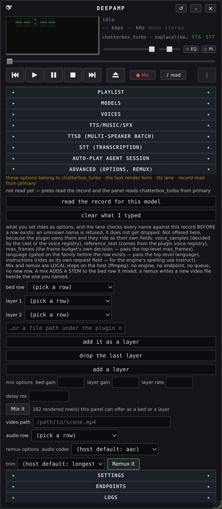

# Advanced (Options, Remux)

Advanced is for engine options a model declares, and for mix and remux of finished takes on this machine.

1. **What is on the screen, top to bottom.**
   1. The amber line: which model this block belongs to, which form, which lane, and where the record was read from. Before the record is read it says so.
   2. `read the record for this model` and `clear what I typed`.
   3. The paragraph naming the option fields this lane passes as their own fields, and how each is passed.
   4. Mix: a bed row, two layer selects, a file path for a stem that is not a row, `add it as a layer`, `drop the last layer`, `add a layer`, per-layer options / gain / rate / delay, `Mix it`.
   5. Remux: a video path, an audio row, the audio codec and the trim mode (each select names the host's default), `Remux it`.

2. **Use it.** Pick a finished take as the bed, pick a second as layer 1, set `delay ms` to `1500`, press `Mix it`: a stem is added to the bed row and nothing new appears in the playlist. A remux writes a new file beside the one you named. Both are ffmpeg steps on this machine — no engine, no endpoint, no queue slot.

3. **What it refuses.**
   1. An option name the model's record does not declare. Refused before any row exists.
   2. A bed named by a word that matches more than one stem. Refused with its stem list, never guessed.
   3. More than 12 layers, and any path outside the plugin's store root.

4. **Details.** The bar refuses from known capability only: an unknown model or an unreadable record is not a refusal. Read the record first — the fields it names and their defaults come from it, not from this page.

**Also:** [../README.md](../README.md) for the verbs, [../AGENTS.md](../AGENTS.md) for the rules, [../CHANGELOG.md](../CHANGELOG.md) for what changed.
