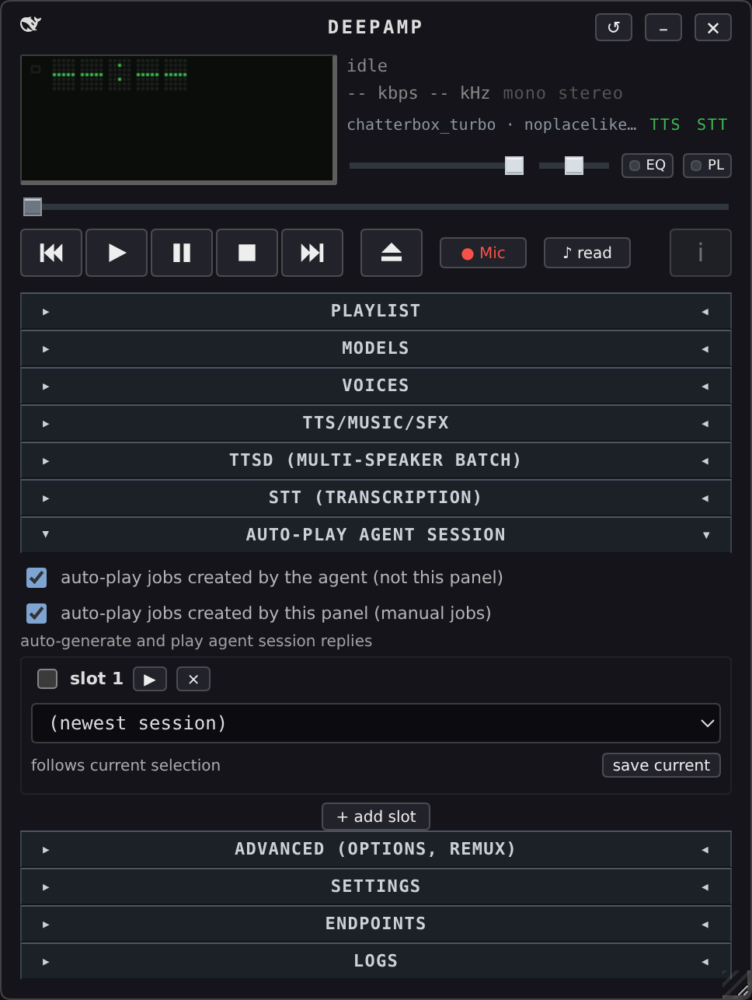

# Auto-play Agent Session

Auto-play is for playing finished takes without being asked, and for speaking an agent session.

1. **What is on the screen, top to bottom.**
   1. Two checkboxes: one for takes an agent asked for, one for takes this panel's own press asked for. Separate switches, remembered for this browser.
   2. The slot list. Each slot: a checkbox that arms it, a play button, a remove button.
   3. The session select each slot carries. `(newest session)` means the conversation this panel is in.
   4. The binding line: `follows current selection` while it follows the panel, `save current` to pin it to what is in use now.
   5. `+ add slot`.

2. **Use it.** Arm a slot, leave it on `(newest session)`, press its play button: the panel speaks the last agent message with the model and voice the form is currently on. Press `save current` and that press keeps using them after you change the form.

3. **What it refuses.**
   1. Nothing that was already in the list when the panel opened. No replay of mount history.
   2. The same take twice, once because an agent asked and once because this panel asked.
   3. A slot with nothing to speak. The refusal says what to fix.
   4. A queued, refused or failed row. A row has to be finished to be heard.

4. **Details.** The control that arms the auto-generation chain is not in this section. It sits beside the run buttons and on the player window's quick music line, and all three arm the same chain and read the same state. How many takes it keeps ahead is a number in [DETAILS_SETTINGS.md](DETAILS_SETTINGS.md). With no panel open, the chain's state is reported as **unknown**, not off.

**Also:** [../README.md](../README.md) for the verbs, [../AGENTS.md](../AGENTS.md) for the rules, [../CHANGELOG.md](../CHANGELOG.md) for what changed.
