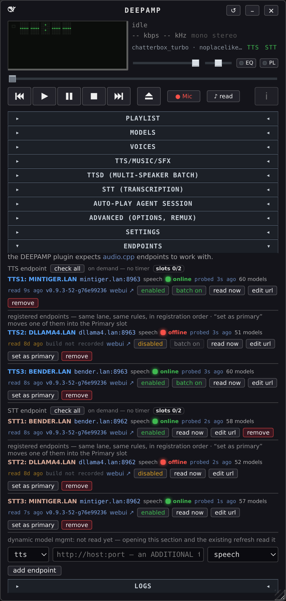

# Endpoints

Endpoints is for the slots this plugin may place work on: what is registered, whether each one answers, what it serves, and which one is primary.

1. **What is on the screen, top to bottom.**
   1. One block per lane. Each block opens with the slot in the Primary position, then the registered endpoints of that lane in registration order. Same lane, same rules, whatever order they were added in.
   2. A row's own state: the host it is on, which API it serves, when it was last probed, how many models it listed and when that was read, and what the engine reports about itself.
   3. `check all` at the top of a block: probe that lane now — the primary and every registered endpoint, in one go.
   4. Per row: `enabled` / `disabled` puts it in or out of placement, `batch on` allows or refuses multi-part work there, `read now` gets both reads in one press, `edit url` opens an input and a Save in the row, `unload <name>` evicts one model from that engine now, `unload all` asks that engine to drop every model it is holding that is not mid-render, and `remove`.
   5. `set as primary` on a registered row: one call that moves that endpoint into the Primary slot and the previous one into its place.
   6. The add row at the bottom: which lane it joins, which API it serves, its address, and `add endpoint`.

2. **Use it.** Press `check all` when you want to know whether the lane answers right now. Press `read now` on one row when you want what that engine serves. Press `set as primary` on the machine you want new work to start from.

3. **What it refuses.**
   1. `remove` takes two clicks — the first only arms it — and the host refuses while a job is running on that endpoint.
   2. A duplicate address, or an address that is already registered, is refused before it is accepted.
   3. An endpoint you took out of placement gets nothing at all, so its batch setting cannot matter there.
   4. A slot a job names is evaluated alone. It never falls back to another one.
   5. A slot held by the operator stays held. The order for that lane is: start the unit, then release the slot.
   6. Neither unload control is offered while a job is mid-way through a model on that endpoint — the refusal names the row it is protecting, and one model slot on an engine IS that row's work in progress. `unload <name>` is offered only for models a `read now` named, because a name is what an eviction needs. `unload all` needs no names: the engine walks its own models and answers which it dropped, so it works on a row whose list read is old. Both are the manual form of what the engine does on its own idle timer.

4. **Details.** Nothing here is polled on a timer: a row is probed when the section opens and when you press. Liveness is `/health`, never `/status`, because `/status` blocks while an engine is rendering. An engine that says it cannot load a model because every loaded model is busy is answering about a healthy endpoint — the row waits rather than failing (`../AGENTS.md` 5.7). A model list is read with a request that names the lane and the slot, and registry ids are a global sequence that is never reused, so a number means nothing beyond the row it names (`../AGENTS.md` 4). An engine that has lost its GPU context can keep answering `/health` for hours while every model reads unloaded; only a hand restart of that unit recovers it, and a restart is allowed for a remote unit that is not in use (`../AGENTS.md` 5.12).

**Also:** [../README.md](../README.md) for the verbs, [../AGENTS.md](../AGENTS.md) for the rules, [../CHANGELOG.md](../CHANGELOG.md) for what changed.
