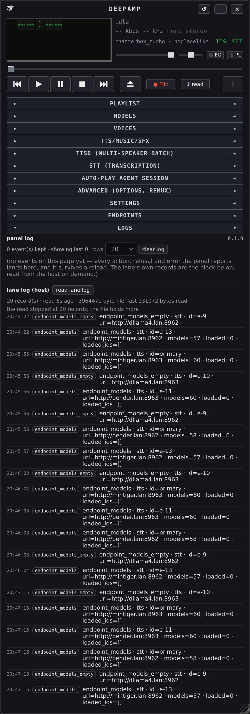

# Logs

Logs is for reading what happened: this panel's own account of what it asked for and what it was told, and the last lines of the lane's log.

1. **What is on the screen, top to bottom.**
   1. The panel log: every action, refusal and error this page reported, newest first. It survives a reload.
   2. How many events are kept and how many are shown, with a select for how many this section lists — 5, 10, 20, or every event the panel still holds.
   3. `clear log`.
   4. The lane log, the host's own record. Opening this section reads it once; `read lane log` reads it again when you want it.

2. **Use it.** Something did not happen the way you expected: open this section, read your row's id in the panel log, then press `read lane log` and find the same id there. Those two readings are the whole of what this section is for.

3. **What it refuses.**
   1. `clear log` clears this page's log and its stored copy. No job, no file and no host record is touched.
   2. `read lane log` changes nothing: no job moves, nothing is written.
   3. The panel log is not the lane's record. A refusal you read here is what this page was told, not what the plugin did.
   4. Nothing here is fetched on a timer. Both halves are read when the section opens or when you press.

4. **Details.** The lane log is one line per event — the event name and the fields a reader needs, never a dumped state object (`AGENTS.md` 5.19) — and it is a file under the plugin's store root, which the `perf_log` Config field decides whether the plugin writes at all (`AGENTS.md` 6). A row's own answer is a better source than either log for one question: what a job is waiting for is on the row, in its park key and its `park_reason` (`AGENTS.md` 5.7).

**Also:** [../README.md](../README.md) for the verbs, [../AGENTS.md](../AGENTS.md) for the rules, [../CHANGELOG.md](../CHANGELOG.md) for what changed.
