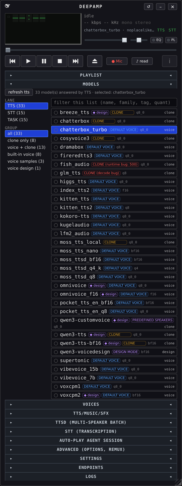

# Models

Models is for reading what the endpoints on this lane actually answer: the model list, what each model can be asked to do, and which one the next take will use.

1. **What is on the screen, top to bottom.**
   1. The header line: how many models answered for this lane, and which one is selected.
   2. Three tabs — the TTS list, the STT list, and the task list. The task list is filtered by job kind, so its rows are for reading, not for picking, and the hover says so.
   3. The group list beside them: everything, and the groups the dispatch select uses. The library and the form sort models the same way on purpose.
   4. The filter field. It narrows the item list only: it changes no state, sends nothing, and does not move the group counts.
   5. The model rows. A filled dot means that build is resident on this lane, a hollow one means it is not. The row carries the name; the hover carries the family, the quant, what the model is for, and how it handles a voice.
   6. `refresh` — re-read this lane's list from its endpoints.

2. **Use it.** Press `refresh`, type a word in the filter, press a row: that model is what the next take on that lane asks for. Press a row you cannot pick and the hover names the reason instead of doing nothing.

3. **What it refuses.**
   1. A model no endpoint listed is not in the list. This section is what the engines answered, not a catalogue.
   2. A model nothing has described is labelled `unknown`, not guessed into a kind. A model whose task token this table does not know stays visible in an unnamed group rather than vanishing.
   3. A filter that matches nothing says so and names how many are in the view.
   4. Nothing is read on a timer. The list is read when the section opens and when you press `refresh`.

4. **Details.** The dot is a fact about the endpoint, not about your choice: only the highlighted row is a selection, and a resident build gets no colour of its own so that one colour cannot mean two opposite things. The counts on the group names are the whole lane, not what your filter is showing. What a dispatch then refuses, and why `force` exists, is `AGENTS.md` 5.9.

**Also:** [../README.md](../README.md) for the verbs, [../AGENTS.md](../AGENTS.md) for the rules, [../CHANGELOG.md](../CHANGELOG.md) for what changed.
