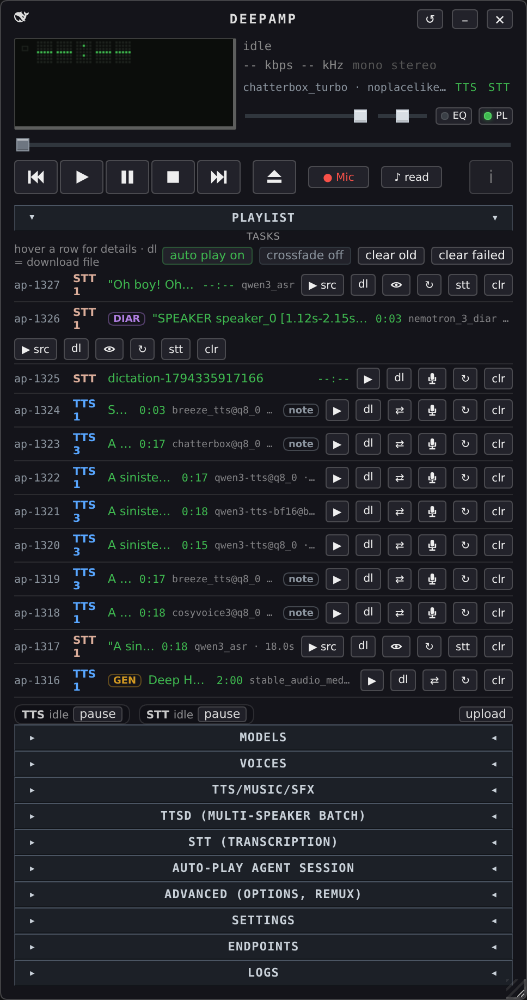

# Playlist — the player window

Playlist is for the rows this plugin has produced, and for playing them back.

1. **What is on the screen, top to bottom.**
   1. The row list. One row per job this plugin has run, of every kind, newest first. A row carries its id, which slot it ran on, its kind, the text it was asked with, its length, and the model and quant it actually ran on. Hover a row for the rest; `dl` is its download link.
   2. The row's own four controls: `▶` plays it, `⇄` writes the same audio into another container as a NEW row with its own file, `↻` puts that row's prompt text into the music / sfx field for the next take, `clr` takes the row out of the list.
   3. `auto play` — when a take this panel played reaches its end, play the next row in the order the lane made them.
   4. `crossfade` — fade at that handover instead of stopping one file and starting the next at full level. The length is a number in [DETAILS_SETTINGS.md](DETAILS_SETTINGS.md).
   5. `clear old` and `clear failed`.
   6. `pause` on each lane: hold new jobs on the TTS lane, or on the STT lane.
   7. `upload` — a file this browser holds, written once into the plugin's store and listed as a row, so it can be replayed, transcribed, or used to make a voice.

2. **Use it.** Press `▶` on a finished row to hear it. Press `↻` on a take you liked and its prompt is sitting in the generator field, ready for another run. Press `⇄` when you want that audio as another container and want the original row left alone.

3. **What it refuses.**
   1. A queued, running, paused or failed row has nothing to play. The row says where it is waiting and why.
   2. `clr` removes the row and never the file. Nothing in this panel deletes a take from a row.
   3. `clear old` keeps the newest 10 finished rows and takes a waiting row out of the queue with the rest.
   4. `clear failed` takes out the rows that never produced a playable take — the lane's own failure, a job a person stopped, and a job taken out of the line before it ran.
   5. `pause` on a lane is not switching an endpoint off. Endpoints are switched off in [DETAILS_ENDPOINTS.md](DETAILS_ENDPOINTS.md). A job already running finishes.

4. **Details.** `auto play` hands over in the order the lane made the rows, and a row that is still rendering is waited for rather than skipped. A crossfade needs a take long enough to fade: the floor is three fade-lengths, so at the default 2.5 s nothing under 7.5 s is faded, and a row whose prompt came from an `sfx` preset folder is never the side a fade moves. The rules behind that are `AGENTS.md` 11.8 and 11.18.

**Also:** [../README.md](../README.md) for the verbs, [../AGENTS.md](../AGENTS.md) for the rules, [../CHANGELOG.md](../CHANGELOG.md) for what changed.
