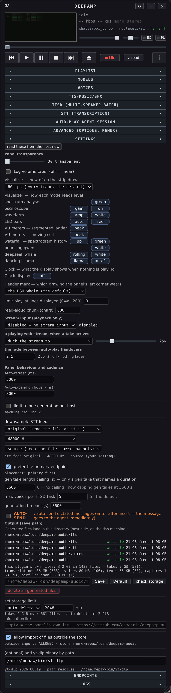

# Settings

Settings is for how the panel behaves and what the lane is allowed to do: what the display draws, how often the panel asks, how long and how big a take may be, and where the files live.

1. **What is on the screen, top to bottom.**
   1. `re-read settings from host`. The panel reads these values once when the section opens, or when you press this.
   2. The output half: the store root and whether it is writable, room left on that disk, what this plugin's own files add up to, `Save` / `Default` / `check storage`, `delete all generated files`, and the take-size bound — what the bound does, and where the line sits.
   3. The display: one row per visualizer mode, each with its own options (colour, counts, how it reads level, which way it moves), the draw rate, the clock and which face it uses, and the header mark.
   4. The player: window transparency, how a slider position maps to loudness, whether an external stream is accepted, what happens when a take arrives while a station is playing and how loud that station stays, and the length of the fade between auto-play handovers.
   5. The panel's own cadence: how often it asks the lane for status, how long the pointer must rest before the panel opens itself, how many playlist lines are shown, and how big a read-aloud chunk is.
   6. The lane's limits: prefer-primary, the per-machine cap, the longest duration a generated take may ask for, the most speakers one task may carry, how long one job may run, the shape the transcription audio is fed at, and how many generations the auto-generation chain keeps ahead.
   7. The two paths: the yt-dlp binary, and whether a typed path may import a file from outside the store.
   8. The address the player's info button opens.

2. **Use it.** Type `4` into the fade field and every auto-play handover fades for four seconds instead of two and a half. Set the take-size bound to `512` in `auto_delete` and the lane starts deleting to stay under it.

3. **What it refuses.**
   1. A number outside its range is refused, and the field names the range it accepts.
   2. A store root that is not an absolute path, or whose parent directory does not exist, is refused.
   3. A yt-dlp path that is a bare name is refused. Capture stays unavailable until that field names a binary.
   4. `delete all generated files` deletes generated audio only: transcripts stay, playlist rows stay, the voice registry is not touched.
   5. A task that asks for more speakers than the ceiling has is cut to the ceiling, and the plan says so before anything is queued.

4. **Details.** Two different things live in this section: the display and cadence values belong to this browser and are kept under `deepamp:*`, and the lane limits belong to the host, which is why the panel reads them rather than holding its own copy. Precedence for anything the host can be told from more than one place is environment, then declared Config, then the state file, then the built-in default (`AGENTS.md` 6). The generation ceiling gates a duration a caller asked for; a model's own default length is not one of those (`AGENTS.md` 5.17). The speaker ceiling does not re-cast a scene: a scene carrying more voices than the ceiling splits into more takes, and at the default of 5 a six-voice scene plans two parts. The job timeout also sets the take budget and the engine poll deadline, so a value under a minute cuts real work short. The pipeline depth does nothing at all unless the auto-generation chain is armed.

**Also:** [../README.md](../README.md) for the verbs, [../AGENTS.md](../AGENTS.md) for the rules, [../CHANGELOG.md](../CHANGELOG.md) for what changed.
