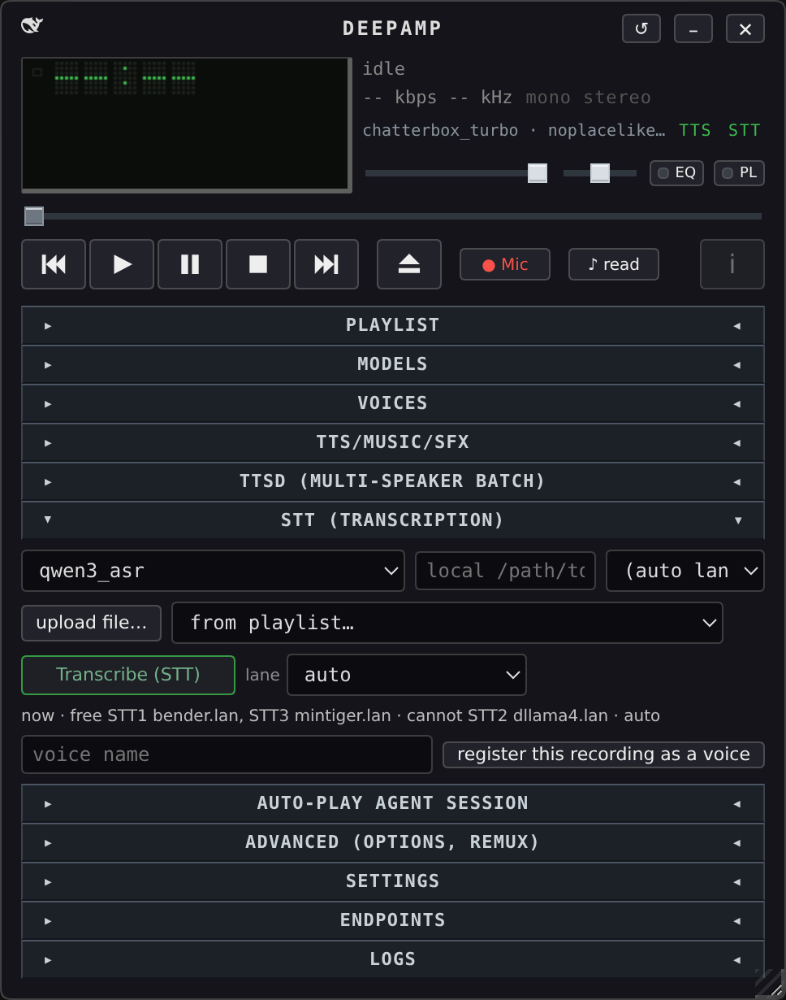

# STT — transcription

STT is for turning audio into text: a take this plugin made, a file on this machine, or something you record now.

1. **What is on the screen, top to bottom.**
   1. The lane line: which transcription slots are free right now, and `auto`, which names none.
   2. The model select for this press. A speaker-separated read has its own default on the plugin side and this control does not choose it.
   3. The language select: a full language name, or none. Some engines refuse short codes.
   4. The source, three ways: a path in the field, `from playlist…` (a row this panel made), or `upload file…`.
   5. The slot select: `auto`, or one slot you name.
   6. `Transcribe (STT)`.
   7. The voice pair under it: a name field and `register this recording as a voice`. This is where a voice is created — the pair sits with the file it consumes.
   8. The cast line, when the source is a row this panel made: which voices that take was rendered with, how many speakers the answer named, and the difference said out loud when the two disagree.

2. **Use it.** Put a path in the field — a take's own path under the plugin store works — leave the slot on `auto`, press `Transcribe (STT)`. To make a voice from something you recorded: type one word in the name field, press `register this recording as a voice`, and the sample is normalised, transcribed for its reference text, and filed under that name.

3. **What it refuses.**
   1. A file the plugin cannot read is refused before anything is queued.
   2. A model the transcription slot does not list is refused.
   3. A name that is not `[a-z0-9_-]`, 1 to 64 characters, is refused by the register control.
   4. The register control takes the audio the box is holding. It does not save the transcript text.
   5. A slot you name is evaluated alone. It never falls back to another one.

4. **Details.** A transcription request holds its connection open until the job reaches a terminal state — a client timeout is not a failure, the row exists and is running (`../AGENTS.md` 5.6). The shape the audio is fed at is a Settings choice, and its default exists because a mismatched rate answers `200` with an empty transcript: a silent wrong answer (`../AGENTS.md` 6). A speaker-separated read is the lane's own model, its result is the row's `speaker_turns`, and the cast line only appears when the source is a row this panel made — an uploaded file has no cast to compare against. Text fields elsewhere in the panel carry a dictation dot: record, transcribe, and the text lands in that field and nowhere else.

**Also:** [../README.md](../README.md) for the verbs, [../AGENTS.md](../AGENTS.md) for the rules, [../CHANGELOG.md](../CHANGELOG.md) for what changed.
