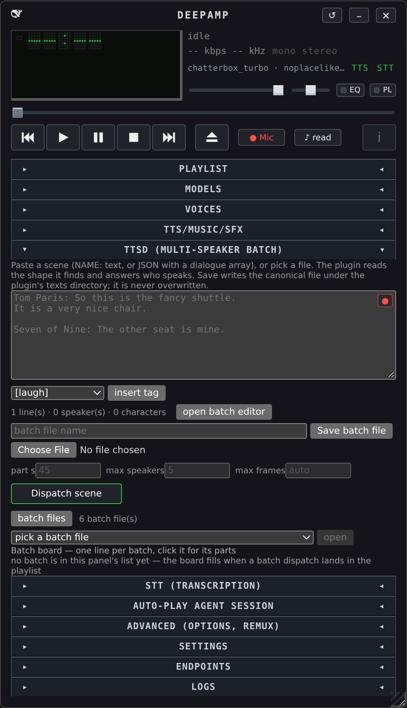
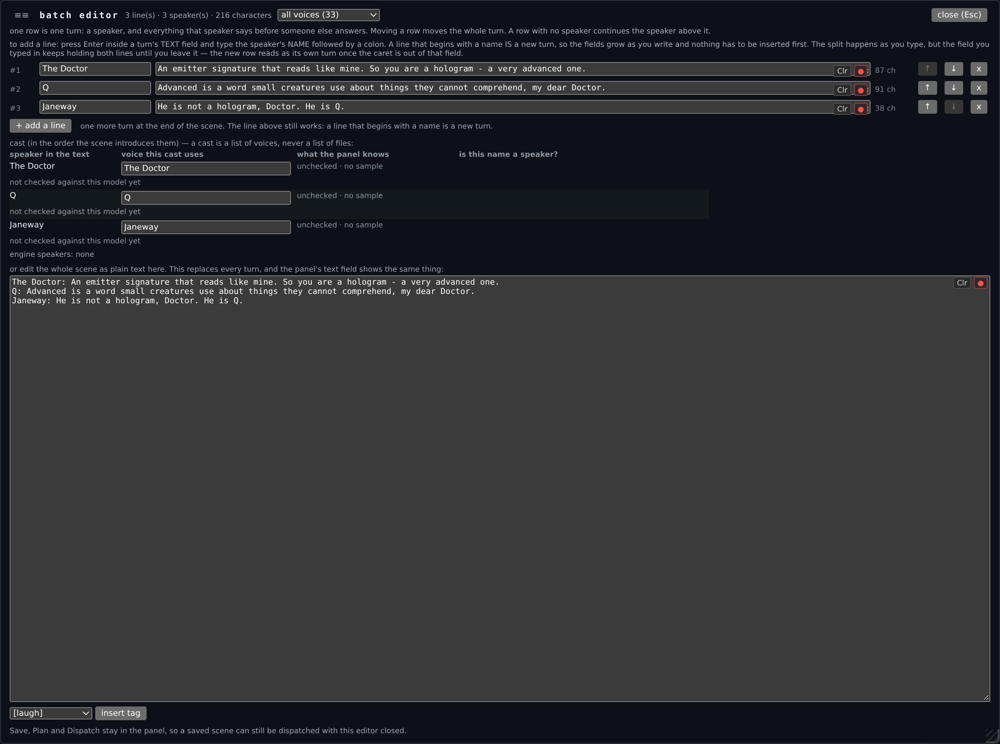

# TTSD — multi-speaker batch

TTSD is for multi-voice dialogue generation.



1. **What is on the screen, top to bottom.**
   1. The scene field. It takes `NAME: text` lines or JSON carrying a dialogue array.
   2. Tag select and `insert tag`.
   3. The count line — lines, speakers, characters, read from what is in the field — and `open batch editor`, where each line names its speaker.
   4. A name field and `Save batch file`, which writes under the plugin's texts directory. `Choose File` takes a document already in the store.
   5. Three bounds: `parts`, `max speakers`, `max frames`.
   6. `Dispatch scene`, with the auto-generation glyph beside it.
   7. The batch board: a count, `pick a batch file`, `open`. One line per batch; click it for its parts.

2. **Use it.** Three lines, one per speaker:
   ```
   The Doctor: An emitter signature that reads like mine. So you are a hologram - a very advanced one.
   Q: Advanced is a word small creatures use about things they cannot comprehend, my dear Doctor.
   Janeway: He is not a hologram, Doctor. He is Q.
   ```

   

   `open batch editor` opens that window: one row per turn, who speaks, what they say, in which order. Press Dispatch scene. Each part is a bounded single-voice take and the parts appear as rows in the playlist.

3. **What it refuses.**
   1. A line with no speaker. Refused before any part row exists.
   2. A cast over the ceiling — 5, adjustable down to 1. Naming fewer is honoured; naming more is clamped to it and the answer names the number that resulted. More voices in one take is where identity drift shows up.
   3. A scene file whose declared bound disagrees with the request. Both numbers are named.
   4. A batch name already in the store. Not overwritten.
   5. A model the rendering slot does not list.
   6. A scene or an episode render asked by an agent. The guard turns it into an ask.

**Also:** [../README.md](../README.md) for the verbs, [../AGENTS.md](../AGENTS.md) for the rules, [../CHANGELOG.md](../CHANGELOG.md) for what changed.
