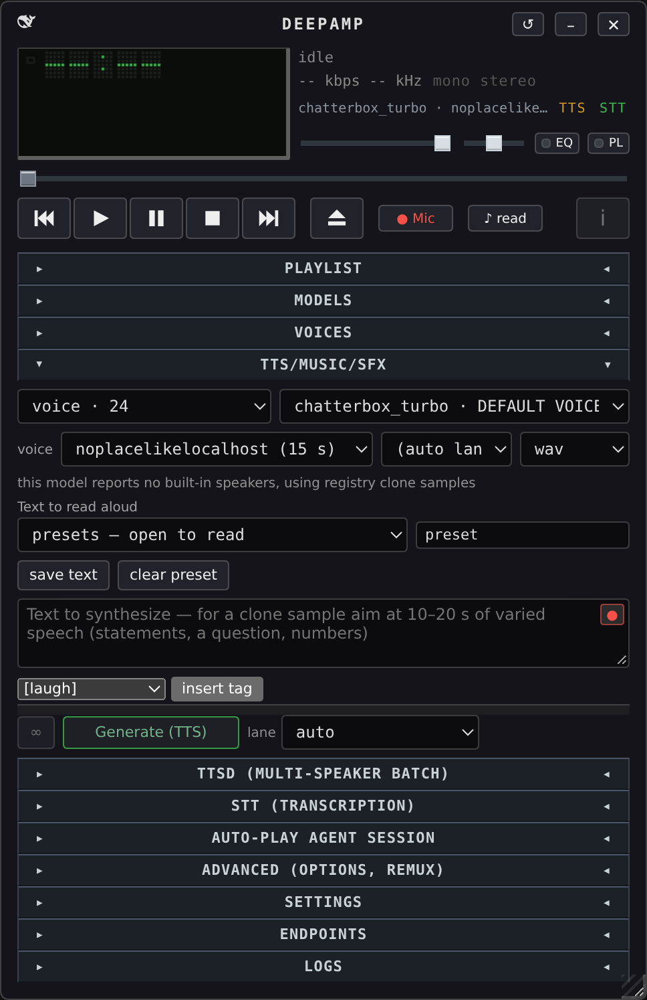

# TTS / MUSIC / SFX

TTS covers Text to Audio for speech, music, sfx, and the other kinds this form offers.

1. **What is on the screen, top to bottom.**
   1. Kind select — the kind, with the count of models the live slot offers for it.
   2. Model select — what that kind resolves to. An entry marked DEFAULT VOICE needs no reference sample.
   3. Speaker fields, where the kind needs one, and the output-format select. The line under them states what the model reports about its own speakers.
   4. Preset line — open a saved prompt, type a name to save under, the save doors, clear.
   5. The text field. A sentence for speech, a prompt for a generation.
   6. Tag select and `insert tag`.
   7. Run button, the auto-generation glyph beside it, and the lane select after it. A pinned lane is evaluated alone.
   8. Generation kinds only: the length field. Empty sends nothing and the model renders at its own default.

2. **Use it.** Type the prompt, set the length, press Generate. The row appears in the playlist and the take plays when it lands.

3. **What it refuses.**
   1. An empty field. Refused before any row exists.
   2. A clone with no voice. No silent fallback.
   3. A model the target slot does not list.
   4. A preset name already in the store. Not overwritten; the name field is rewritten with the name the host suggested, and pressing save again uses it.
   5. A length above the ceiling. A length you typed is never replaced.
   6. A preset from a folder that names no side. The words still land, nothing is guessed.

4. **Details.** A prompt is saved into a side folder — music, sfx, or voice — and the side is what the folder says, not what the text sounds like. A pick carries the model that preset was used with, which is a pairing the panel recorded from a real run. When its own records disagree about that pairing, the pick says so in one line.

**Also:** [../README.md](../README.md) for the verbs, [../AGENTS.md](../AGENTS.md) for the rules, [../CHANGELOG.md](../CHANGELOG.md) for what changed.
