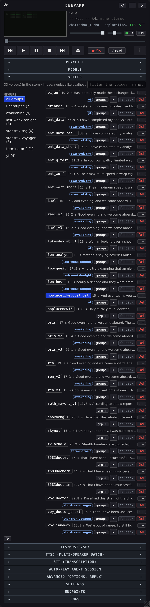

# Voices

Voices is for the voice registry: the reference samples this plugin holds, the text each one was transcribed from, and which voice a take is asked to speak with.

1. **What is on the screen, top to bottom.**
   1. The header line: how many voices the store holds, and which one is in use.
   2. The group tree: every group you have filed voices under, with a count each, plus `ungrouped`.
   3. The filter field: name, origin, or a line of the reference text.
   4. The voice rows. Press the name to pick that voice for the next take. Each row carries its reference length, a `› +` that opens the whole reference text, a button that plays the sample in the player, `groups` to file it under your own labels, and `Del`.
   5. `fallback` on one row: the voice this panel uses when its own pick did not survive a reload.
   6. The reload control at the end of the list: re-read the plugin registry and the built-in speaker list of the model currently selected.

2. **Use it.** Press a name to pick it. Press the play button on that row to hear exactly the file an engine will be given. Type two words of a line someone said into the filter and the voice you filed months ago is the only row left.

3. **What it refuses.**
   1. `Del` is the end of the voice. The plugin store is the only copy: the entry and its WAV go with it.
   2. A group is a label on the entry, not a directory. Nothing moves on disk.
   3. The filter changes no state and sends nothing.
   4. A voice is not registered from this section. The name field and the register control sit with the file they consume, in [DETAILS_STT.md](DETAILS_STT.md).

4. **Details.** The length on a row is a measurement of the sample, cached so the list does not re-probe it. A model that lists its own speakers is offered those names beside this registry; a model that lists none renders on its own voice — the one vocabulary for that is `AGENTS.md` 5.10. Nothing here copies a sample to an engine: an endpoint sees it only when a clone actually runs. The store is the single source of truth for voices, and no shelf or remote copy of a sample is kept.

**Also:** [../README.md](../README.md) for the verbs, [../AGENTS.md](../AGENTS.md) for the rules, [../CHANGELOG.md](../CHANGELOG.md) for what changed.
